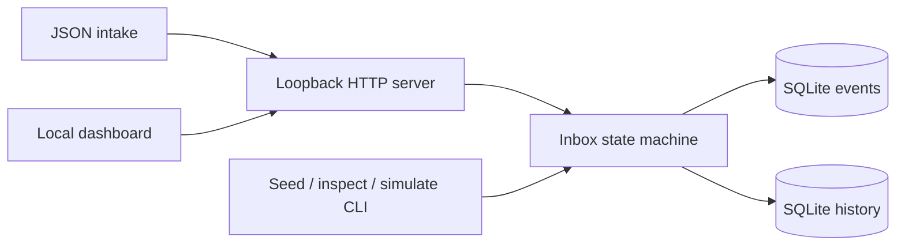
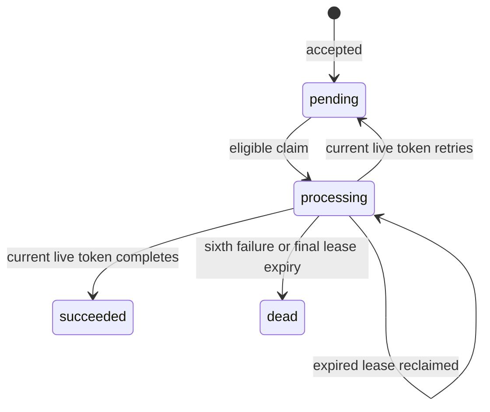

# Architecture and decisions

## One database is the coordination boundary

`core.py` owns the schema and transitions. `server.py` maps HTTP requests onto that core and serves two fixed demo assets. `worker.py` performs local CLI operations and shares the strict JSON parser from `server.py`. `dashboard.html` fetches real event state and renders stored values through DOM `textContent`, avoiding interpretation of payloads as markup. There are no runtime dependencies or outbound network calls.

Each operation opens its own SQLite connection. WAL permits readers while a writer operates; SQLite still serializes writers. `synchronous=FULL` asks SQLite for its full synchronization behavior, and event changes and their history entries commit together. The tests establish application behavior on this machine; they do not simulate storage failure or prove durability on every filesystem. A 10-second SQLite lock timeout maps to HTTP 503 when storage cannot be obtained.

## Intake identity

An event stores a random identifier, a unique idempotency key, canonical payload JSON, its SHA-256 digest, state, attempt count, eligibility time, current lease capability, timestamps, and last error. Intake uses a writer transaction to check for an existing key before inserting.

Canonicalization uses Python's sorted object keys, compact separators, UTF-8, and finite JSON values. Whitespace and object key ordering do not affect identity. Numeric representations such as `1` and `1.0`, array ordering, and different Unicode normalization forms can produce different digests. This is a project-local convention rather than RFC 8785 canonicalization. The digest detects conflicting payload reuse; it does not authenticate the sender. A matching duplicate returns the original event without adding history or resetting its state.

## Leases and transition invariants

A claim starts `BEGIN IMMEDIATE`, then reads the clock inside that transaction. It sweeps expired final-attempt leases into `dead`, selects the earliest eligible event, increments its attempt count, generates a fresh random token, and sets a 30-second expiry. Selection, token replacement, and history all occur before commit. Concurrent claimants cannot each select the same unexpired work.

Complete and retry also obtain the writer transaction **before** checking time. They require `processing`, the exact current token, and an expiry strictly later than the current time. A token is stale at the expiry boundary, even before another worker reclaims the event. Tokens are returned only on claim and are excluded from normal inspection and history. The regression test with a held SQLite writer lock protects against accepting a completion whose lease expired while it waited for that lock.

An explicit retry clears the lease and sets the next eligible time to `now + min(30, 2 * 2^(attempt - 1))`. Delays are 2, 4, 8, 16, and 30 seconds. Attempt 6 is the final attempt; retrying it records exhaustion instead of creating a seventh opportunity. A worker crash is recovered when a later claim observes its expired lease; this recovery waits for the 30-second lease, rather than applying the explicit retry delay. If that was the sixth lease, the next claim marks it dead. Read-only inspection does not sweep expired leases, so an expired record can still display `processing` until a claimant runs.

The intended processing model is at least once. A process may finish work and die before acknowledging it, and a timed-out claim response may still have committed. An external processor would need its own idempotent side-effect boundary. This project deliberately simulates processing and performs no external side effects. There is no claim of exactly-once delivery.

## HTTP and CLI boundaries

`ThreadingHTTPServer` binds only to `127.0.0.1`. Request bodies are bounded to 65,536 bytes and use a 3-second socket timeout. Chunked transfer encoding, duplicate length headers, duplicate JSON keys, non-object payloads, and non-finite payload values are rejected. Core validation also bounds canonical payload size and requires Unicode scalar values for persisted text. Escaped lone-surrogate keys and retry messages become `InvalidInput` before SQL runs, preserving the current event and lease; valid non-BMP characters remain supported. Response JSON uses ASCII escaping so error serialization remains encodable. The dashboard and synthetic fixture are served from fixed filenames next to the server; other local files are not exposed as static assets.

List responses contain at most 100 summaries. Inspection returns the full history of one event. History growth and database size are unbounded over the lifetime of this demonstration. There is no pagination cursor or retention command. The fixture importer accepts at most 1 MiB and 1,000 entries; each accepted entry commits individually, so an import that later encounters a conflict can have earlier committed entries. Re-running the same matching fixture is idempotent.

Clock values are wall-clock epoch seconds so eligibility persists across restarts. The design assumes a reasonably stable clock on one host. Significant clock adjustments change effective lease and retry durations. Policy values live in `core.py`; all workers sharing one database must run the same version and policy. This is not a distributed queue or a migration framework.

## Dashboard choices

The interface prioritizes the queue and selected event history, rather than invented throughput metrics. The palette uses paper `#f6f8fb`, navy ink `#14213d`, blue action `#2d4db0`, steel rules `#d8e0ef`, teal success `#17766d`, and amber processing `#9c5a12`. Avenir Next/Segoe UI is the main type stack; monospace is reserved for payload and history data. Status always includes a text label, controls have visible keyboard focus, and the two-column workspace becomes one column on smaller screens. It performs no automatic mutations or background polling. Browser visual and interaction review remains separate from the Python tests.

## Extension points

Useful next steps would be signature verification before intake, authenticated worker access, a lease-renewal contract, versioned schema migrations, bounded retention, and an explicitly idempotent processor. Those features need their own contracts and verification; they are not implemented here.
